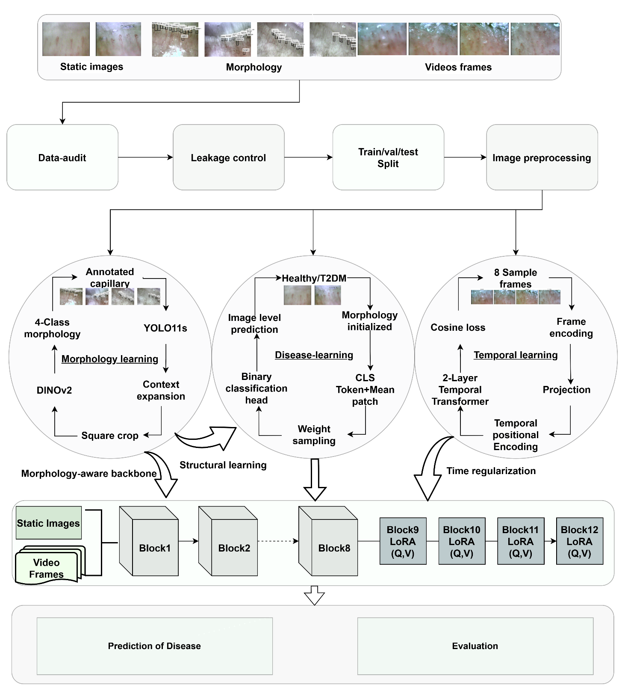
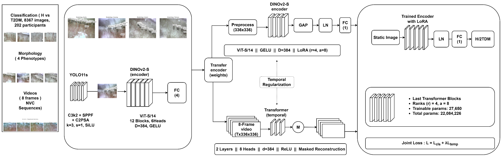

# Morphology-Guided Temporal Regularization for Parameter-Efficient Type 2 Diabetes Classification from Nailfold Capillaroscopy

**Research implementation of the manuscript:** *Morphology-Guided Temporal Regularization for Parameter-Efficient Type 2 Diabetes Classification from Nailfold Capillaroscopy*

This repository provides the data preparation, model training, and evaluation scripts for a nailfold capillaroscopy framework that learns vascular morphology before diabetes classification, uses unlabeled video sequences to regularize temporal representations, and adapts a shared DINOv2-Small encoder through low-rank adaptation (LoRA). The final model predicts **Healthy vs. Type 2 Diabetes Mellitus (T2DM) from a single static image**; a video is **not required at inference**.

The code is organized to reproduce the sequence of experiments described in the accompanying paper, including participant-level partitioning, morphology localization and recognition, static-image disease learning, masked temporal representation learning, and parameter-efficient image–video training.

## Highlights

- **Morphology-aware pretraining:** YOLO11s capillary localization and DINOv2-Small classification of **Bushy, Crossing, Hairpin, and Tortuous** capillaries.
- **Participant-level leakage control:** identifier recovery, image-content hash checking, morphology alignment, and train/validation/test separation.
- **Static-image diagnosis:** morphology-initialized DINOv2-Small for **Healthy/T2DM** classification, trained using participant-balanced sampling.
- **Self-supervised video learning:** eight frames per sequence, two masked positions, and a two-layer temporal Transformer with cosine reconstruction loss.
- **Parameter-efficient fusion:** LoRA in the **query and value projections of the last four** DINOv2 Transformer blocks, with temporal consistency used as a training-time regularizer.
- **Image-only deployment:** diagnosis uses the learned static encoder and classification head rather than requiring an accompanying video.

## Methodology diagram

<p align="center">
  
</p>

*Methodology overview reproduced from Figure 1 of the accompanying manuscript. The video pathway supplies training-time temporal regularization; at inference, the final classifier receives a static nailfold image.*

## Dataset

The scripts use the public **Capillary Dataset** introduced by Nguyen and Jeong (KDD 2025):

- **Dataset:** [HanaNguyen/Capillary-Dataset on Hugging Face](https://huggingface.co/datasets/HanaNguyen/Capillary-Dataset)
- **Source identifier in the code:** `HanaNguyen/Capillary-Dataset`
- **Components:** Healthy and T2DM nailfold capillaroscopy images; four-class capillary morphology images with bounding-box annotations; and capillaroscopy videos.
- **Task labels:** `Healthy = 0`, `T2DM = 1` for disease classification; `Bushy = 0`, `Crossing = 1`, `Hairpin = 2`, `Tortuous = 3` for morphology.

### Classification cohort reported in the paper

| Partition | Participants | T2DM | Healthy | Images |
| --- | ---: | ---: | ---: | ---: |
| Training | 141 | 88 | 53 | 5,800 |
| Validation | 30 | 19 | 11 | 1,243 |
| Independent test | 31 | 19 | 12 | 1,324 |
| **Total** | **202** | **126** | **76** | **8,367** |

The paper reports a separately prepared morphology cohort of **908 training**, **195 validation**, and **195 test** images. The scripts re-create and audit the partition manifests rather than relying solely on pre-existing dataset folders; the exact available records may depend on the upstream dataset snapshot.

**Important distinction:** the disease training and testing code reads `classification_strict_640_manifest.csv`, which contains only the audited **640 × 480** classification images. The table above describes the broader classification image inventory reported in the manuscript. Consult the generated CSV manifests for the actual count used by each training stage.

Data are downloaded from the original publisher, not included in this repository. Please follow the dataset publisher's attribution and usage conditions.

## Repository layout

```text
.
├── README.md
├── dataset_preparation.py       # Download, audit, leakage control, splits, crops, video frames
├── methodology.py               # YOLO11s, DINOv2 morphology, static, temporal, fusion + LoRA training
├── evaluation.py                # Evaluate saved checkpoints and generate paper-style figures
├── requirements.txt
├── .gitignore
└── assets/
    ├── methodology.png         # Methodology figure reproduced from the paper
    └── implementation_architecture.png  # Detailed implementation schematic
```

The supplied Python files were renamed for consistent imports. In particular, `evaluation.py` imports models and utility functions from `methodology.py`. **The underlying Python code has not been altered.**

## Environment and dependencies

The manuscript reports experiments in **Google Colab** using an **NVIDIA L4 GPU (approximately 22 GB VRAM)**, **PyTorch 2.11.0+cu128**, and **CUDA 12.8**. A CUDA-enabled GPU is recommended for training. CPU execution is possible for some steps but is not a practical substitute for the reported training environment.

Install Python 3.10+ and the repository dependencies:

```bash
python -m pip install -r requirements.txt
```

**FFmpeg and FFprobe** must also be available on the system `PATH` to inspect `.mpg` video durations and extract eight frames per sequence. For Google Colab, for example:

```bash
!apt-get update -qq && apt-get install -y -qq ffmpeg
!python -m pip install -r requirements.txt
```

PyTorch/CUDA builds should be installed according to the [official PyTorch installation instructions](https://pytorch.org/get-started/locally/) if a particular accelerator configuration is required. The `requirements.txt` lists the libraries used by the supplied code but does not lock an exact historical Colab environment.

## Reproducing the experiments

Run all commands **from the repository root**. Stages use intermediate files produced by earlier stages; execute them in the order shown below.

### 1. Download and prepare the dataset

```bash
python dataset_preparation.py --data-dir data/Capillary-Dataset --output-dir artifacts
```

This command:

1. Downloads the Hugging Face dataset using `snapshot_download`.
2. Creates file inventory and integrity audits; identifies exact duplicate pixel content.
3. Builds participant-disjoint training, validation, and independent-test splits.
4. Resolves and partitions morphology images using participant associations or conservative image-content grouping.
5. Prepares YOLO11s detection data and annotation-derived capillary crops (with **25% context expansion**).
6. Generates preprocessing inspection examples and extracts **eight frames** from each matched `.mpg` video.

To reuse an already downloaded dataset, add `--skip-download`:

```bash
python dataset_preparation.py --data-dir data/Capillary-Dataset --output-dir artifacts --skip-download
```

**Path note:** the generated CSV manifests contain absolute file paths. Avoid moving the raw data or prepared artifacts after preparation; if their locations change, rerun preparation to regenerate manifests.

### 2. Train the full modeling pipeline

```bash
python methodology.py --artifact-dir artifacts --stage all
```

The `all` option trains the stages sequentially:

| Stage | Training operation | Main output |
| --- | --- | --- |
| `yolo` | YOLO11s capillary detector | `artifacts/models/yolo11s/weights/best.pt` |
| `morphology` | DINOv2-Small, four capillary phenotypes | `artifacts/models/morphology_dinov2.pt` |
| `stage1` | Morphology-initialized Healthy/T2DM image classifier | `artifacts/models/stage1_disease.pt` |
| `temporal` | Two-layer Transformer, masked eight-frame feature reconstruction | `artifacts/models/temporal_model.pt` |
| `fusion` | Shared DINOv2-Small plus video regularization and LoRA | `artifacts/models/fusion_lora.pt` |

Each stage can instead be run independently, **after its prerequisite checkpoints and manifests exist**:

```bash
python methodology.py --artifact-dir artifacts --stage yolo
python methodology.py --artifact-dir artifacts --stage morphology
python methodology.py --artifact-dir artifacts --stage stage1
python methodology.py --artifact-dir artifacts --stage temporal
python methodology.py --artifact-dir artifacts --stage fusion
```

The script saves selected checkpoints and training histories under `artifacts/models/` and `artifacts/histories/`.

### 3. Evaluate checkpoints and generate figures

```bash
python evaluation.py --artifact-dir artifacts
```

The evaluation script loads the saved checkpoints, evaluates morphology, static-image classification, temporal reconstruction, and final Fusion + LoRA classification, and saves:

- **Metrics and predictions:** `artifacts/evaluation/` (CSV files, including `fusion_final_metrics.csv` and `principal_experimental_results.csv`).
- **Experimental visualizations:** `artifacts/paper_figures/` (Figures 03–22 as PNG images).

The final disease evaluation calculates image-level AUROC and participant-level AUROC. Participant-level probabilities are computed by **averaging predictions across each participant's images**. Binary predictions use a **0.50 threshold** for accuracy, balanced accuracy, precision, recall, and F1-score. The independent test partition is evaluated separately from training/validation.

## Implementation Details and Model Architecture

The following implementation schematic illustrates the morphology-localization pathway, DINOv2-based structural representation learning, static-image classification, video-based temporal regularization, and final parameter-efficient adaptation. It complements the methodology overview above by highlighting the model components, input dimensions, and LoRA configuration.

<p align="center">
  
</p>

*Implementation architecture schematic. Temporal information regularizes the shared image encoder during training; the trained model performs Healthy-versus-T2DM inference from an individual static capillaroscopy image.*

**Implementation note:** The diagram is a high-level schematic. For exact computational specifications, the Python source takes precedence: the disease classifier uses a **768-dimensional representation** formed from the 384-dimensional CLS token and mean patch embedding, with a **two-logit output** for Healthy/T2DM (rather than a literal single-neuron `FC(1)` head). The temporal network consumes **384-dimensional frame embeddings** but projects them into a **256-dimensional Transformer hidden space** (the diagram's `d=384` refers to the frame-feature dimension, not the Transformer hidden width). These distinctions are reflected in the table below.

### Architecture and hyperparameters

| Component | Setting reflected in the supplied code |
| --- | --- |
| Base visual encoder | `facebook/dinov2-small` |
| Morphology crop size | 224 × 224, square-padded |
| Disease image / video-frame input | 336 × 336, three-channel grayscale with image-level standardization and ImageNet normalization |
| Classification representation | 384-D CLS token + 384-D mean patch embedding = **768-D** feature |
| Morphology classes | Bushy, Crossing, Hairpin, Tortuous |
| Temporal input | 8 frame features, each 384-D |
| Temporal architecture | 384→256 projection, 2 Transformer encoder layers, 8 attention heads, 512-D feed-forward layers |
| Temporal masking | 2 of 8 frame positions |
| LoRA | Rank 4, α = 8, dropout 0.10, query/value projections of the last 4 encoder blocks |
| Fusion regularization | `L_joint = L_image + 0.05 × L_temporal` |
| Video update frequency in fusion | Every 4 image batches |
| Final training | Up to 15 epochs, AdamW learning rate `3e-5`, weight decay `5e-4` |
| Reproducibility seed | 42 |

The detector is trained using bounding-box annotations, while the morphology classification crops are constructed from the **annotation boxes**, not from a YOLO inference pass. The morphology-trained DINOv2 backbone initializes the Stage-1 disease model. The final temporal Transformer is frozen during LoRA fusion, and the shared encoder is adapted by trainable LoRA modules and the classification head.

## Reported experimental results

The following values are **reported in the accompanying manuscript**, not computed by opening this repository. After reproducing the experiments, check the saved evaluation CSV files for the results obtained in your own environment.

| Independent-test metric (final Fusion + LoRA) | Reported value |
| --- | ---: |
| Image-level AUROC | **0.982** |
| Participant-level AUROC | **0.993** |
| Accuracy | **0.978** |
| Balanced accuracy | **0.979** |
| Precision | **0.988** |
| Recall / sensitivity | **0.977** |
| F1-score | **0.982** |

Additional reported findings:

- Morphology validation AUROC: **Bushy 0.970**, **Crossing 0.972**, **Hairpin 0.980**, and **Tortuous 0.909**.
- Stage-1 independent-test AUROC: **0.893** (image) and **0.982** (participant).
- Temporal reconstruction cosine similarity: **0.844** (validation) and **0.902** (held-out test videos).
- Final fusion: **27,650 trainable parameters out of 22,084,226 total** (approximately **0.13%** trainable).

These results were obtained on the paper's internal participant-held-out test set; **they are not external-dataset validation**. The method is intended for research and has not been established as a standalone clinical diagnostic device.

## Generated artifacts

After the scripts have run successfully, the main output structure is:

```text
artifacts/
├── audit/
│   ├── file_inventory.csv
│   └── dataset_audit.json
├── splits/
│   ├── classification_image_manifest.csv
│   ├── classification_participant_splits.csv
│   ├── classification_split_summary.csv
│   ├── classification_strict_640_manifest.csv
│   ├── morphology_image_manifest.csv
│   └── morphology_split_summary.csv
├── prepared/
│   ├── morphology_yolo/
│   ├── morphology_crop_manifest.csv
│   ├── video_frame_manifest.csv
│   ├── video_train_frame_manifest.csv
│   ├── video_val_frame_manifest.csv
│   └── video_test_frame_manifest.csv
├── models/
├── histories/
├── evaluation/
└── paper_figures/
```

Checkpoints, raw datasets, frame extractions, and generated experimental artifacts are excluded from Git by the provided `.gitignore` because they may be large and can be regenerated.

## Reproducibility and limitations

Participant assignments and audit records are saved as CSV/JSON. The scripts use a fixed seed, explicitly separate held-out subjects, and avoid incorporating T2DM-only video availability as a supervised diagnostic feature. They download the source dataset and pretrained model weights when required; connectivity, package compatibility, and the upstream dataset snapshot can affect reproducibility. The supplied code does not offer a separate command-line inference interface for arbitrary individual images; it provides training and evaluation using the prepared manifests.

The experiments address **Healthy vs. T2DM** using the available nailfold dataset. Further clinical assessment should include external cohorts, additional diseases, diverse imaging devices, and prospective validation.

## Citation and acknowledgments

**Accompanying manuscript:** *Morphology-Guided Temporal Regularization for Parameter-Efficient Type 2 Diabetes Classification from Nailfold Capillaroscopy*. Formal author, venue, year, and DOI metadata should be added **after the paper's bibliographic details are finalized**; no publication record is assumed here.

**Dataset reference (as cited in the manuscript):**

> H. T. P. Nguyen and H. Jeong, “Capillary Dataset: A Dataset of Nail-fold Capillaries Captured by Microscopy for Diabetes Detection,” *Proceedings of the 31st ACM SIGKDD Conference on Knowledge Discovery and Data Mining*, Vol. 2, pp. 5722–5729, 2025. DOI: [10.1145/3711896.3737425](https://doi.org/10.1145/3711896.3737425).

The implementation uses [Ultralytics YOLO11](https://github.com/ultralytics/ultralytics), [DINOv2](https://github.com/facebookresearch/dinov2), [Hugging Face Transformers](https://huggingface.co/docs/transformers), and PyTorch. Follow each source project's applicable license and usage terms.

## License

**No code license has been specified by the manuscript or the uploaded files.** The repository owner should add a `LICENSE` file once the intended open-source terms are selected. Dataset and pretrained model licensing are separate from the code license.
